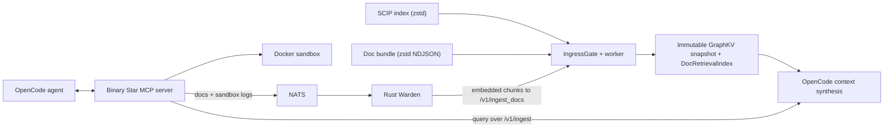

# GraphKV-Engine

GraphKV-Engine is a local runtime that helps coding agents understand a repository without reading all of it. A C++26 WebSocket server ingests SCIP code indexes and long-document bundles into an immutable in-memory graph, then synthesizes small, evidence-backed context packets for the agent. A Python MCP server (the "Binary Star" profile for OpenCode) sits on top and gives the agent a tight loop: rank a target, edit it against verified coordinates, validate the change in a sandbox, and feed the result back into later retrieval.

The goal is not to dump more repository text into the model. It is to give the agent a smaller, better context surface and grounded, executable evidence instead of broad file browsing.

## Highlights

- **SCIP ingestion over WebSocket.** Zstd-compressed SCIP protobuf is parsed by a custom wire scanner and published as an immutable CSR graph snapshot.
- **Document plane.** Zstd-compressed NDJSON doc bundles are indexed with dense ANN (Unum USearch), native BM25-style sparse postings, and Reciprocal Rank Fusion, with chunks linked to the code graph promoted as graph-connected evidence.
- **OpenCode-native output.** Synthesized context is emitted as an OpenCode `POST /session/{id}/message` body, optionally with a JSON-schema output contract.
- **Proof-carrying edits.** Source coordinates carry `evidence_id` and `range_sha256`, and `edit_source_code` rejects stale spans and returns a before/after proof record.
- **Sandboxed validation as evidence.** `execute_sandbox` runs commands in a Docker workspace snapshot with execution tiers, and failures are recorded in `.graphkv/failure_memory.jsonl` to steer later ranking.
- **Vague-intent routing.** `rank_intent_targets` turns prompts like "fix auth" or a `file:line` stack trace into ranked edit targets using lexical, git-heat, failure-memory and structural signals.
- **Rust Warden sidecar.** Turns documentation and sandbox logs into embedded retrieval chunks over NATS.

## How it works



- **Transport:** Drogon WebSocket endpoints at `/v1/ingest_scip`, `/v1/ingest_docs` and `/v1/ingest` (default port `8888`).
- **Boundary:** a transport-free `IngressGate` classifies frames, parses small JSON control frames with Glaze, and admits compressed binary SCIP by size. The worker reads `ZSTD_getFrameContentSize` before allocating and rejects frames with unknown size or above the 250 MiB limit. The Drogon message cap uses the same value.
- **Dispatch:** binary work goes to a bounded worker dispatcher instead of detached per-message threads. Ingest metrics go through an SPSC `TelemetryRingBuffer`.
- **Storage:** snapshots own their string bytes in a contiguous `StringTape` with compact `StringRef` handles. A single immutable root is published atomically, protected by Folly hazard pointers in production builds.
- **Execution memory:** see [`docs/EXECUTION_MEMORY_ARCHITECTURE.md`](docs/EXECUTION_MEMORY_ARCHITECTURE.md) for sandbox tiers, snapshot policy and Warden ingestion.

## MCP servers

| Server | File | Tools |
| --- | --- | --- |
| GraphKV Binary Star | `mcp-server/server.py` | `query_context`, `rank_intent_targets`, `read_directory_lens`, `search_source`, `read_source_slice`, `edit_source_code`, `execute_sandbox`, `ingest_web_documentation`, `inspect_git_state` |
| GraphKV Local Search | `mcp-server/search_server.py` | `list_workspaces`, `workspace_index_status`, `graph_stats`, `god_nodes`, `get_node`, `get_neighbors`, `get_community`, `query_graph`, `shortest_path`, `search_symbols` |

The Local Search server reads `graphkv-out/` artifacts produced by `tools/build_graphkv_artifacts.py`.

## Tech stack

- **Engine:** C++26, CMake + Ninja, Drogon, Glaze, Microsoft GSL, Kokkos mdspan, Zstd, Protobuf (compatibility mode), Unum USearch, Folly
- **MCP layer:** Python, `mcp` (FastMCP), `docker`, `websockets`, `nats-py`, `httpx`
- **Sidecar:** Rust (tokio, async-nats, tokio-tungstenite, reqwest, zstd)
- **Container:** NVIDIA TensorRT-LLM devel/runtime images with clang-22

## Getting started

### Prerequisites

- CMake 3.25+, Ninja, and a compiler and standard library with C++26 and `<print>` support
- Python 3 and [uv](https://github.com/astral-sh/uv) for the MCP servers and helper tools
- Docker (for the container build and for `execute_sandbox`)
- Optional: a NATS server and the Rust toolchain for the Warden sidecar

### Build and test the engine

```sh
cmake -S . -B build -G Ninja -DCMAKE_BUILD_TYPE=Release
cmake --build build --target scip_ingest_server
ctest --test-dir build --output-on-failure
```

If your standard library lacks `<print>`, build the core only:

```sh
cmake -S . -B build -G Ninja -DGRAPHKV_BUILD_SERVER=OFF -DGRAPHKV_REQUIRE_STD_PRINT=OFF
```

Useful CMake options: `GRAPHKV_ENABLE_USEARCH` (default `ON`), `GRAPHKV_REQUIRE_FOLLY` (default `OFF`, set `ON` for production snapshot reclamation), `GRAPHKV_MAX_INGEST_BYTES` (default `262144000`), `GRAPHKV_BUILD_FUZZERS` (default `OFF`). Legacy `GRAPHIFY_*` names are still accepted as aliases.

### Run the server

```sh
./build/scip_ingest_server                      # listens on 8888
GRAPHKV_PORT=8899 ./build/scip_ingest_server    # pick another port
```

Send a SCIP index or a document bundle (both helpers compress with Zstd before sending):

```sh
python3 tools/send_scip_ws.py benchmarks/data/index.scip --port 8888

python3 tools/build_doc_bundle.py /path/to/repo \
  --output benchmarks/data/local_repos/mixed_docs.ndjson --max-files 500
python3 tools/send_docs_ws.py benchmarks/data/local_repos/mixed_docs.ndjson --port 8888
```

A successful SCIP ingest returns a response like:

```json
{"ok":true,"mode":"strict-wire-scanner","compressed_bytes":104,"uncompressed_bytes":91,"documents":1,"symbols":1,"relationships":1,"occurrences":1,"arena_bytes":189,"string_bytes":53}
```

### Docker

```sh
docker build -t graphkv-engine .
docker run --rm -p 8888:8888 graphkv-engine
```

The image builds pinned Folly and FastFloat, configures with `-DGRAPHKV_REQUIRE_FOLLY=ON`, and ships `graphkv-warden` and `warden_profile` in `/opt/graphkv/bin`. `benchmarks/docker_e2e_profile.py` rebuilds the image, smoke tests both WebSocket routes and writes a JSON profile report.

### MCP servers

```sh
uv run --with-requirements mcp-server/requirements.txt python mcp-server/server.py
uv run --with-requirements mcp-server/search_requirements.txt python mcp-server/search_server.py
python3 tools/build_graphkv_artifacts.py /path/to/repo   # writes graphkv-out/ for the search server
```

Configuration is by environment variable. Binary Star reads `GRAPHKV_WORKSPACE_ROOT`, `GRAPHKV_QUERY_WS_URL`, `GRAPHKV_NATS_URL`, `GRAPHKV_MCP_SANDBOX_IMAGE`, `GRAPHKV_MCP_SANDBOX_SNAPSHOT_MODE`, `GRAPHKV_MCP_TRANSPORT`, `GRAPHKV_MCP_LENS_DEPTH`, `GRAPHKV_MCP_LENS_MAX_ENTRIES`, plus optional auth settings (`GRAPHKV_MCP_REQUIRE_AUTH`, `GRAPHKV_MCP_ACCESS_TOKEN`, `GRAPHKV_MCP_AUTH_INTROSPECTION_URL`, `GRAPHKV_MCP_TRUSTED_TOKENS_FILE`). The search server reads `GRAPHKV_WORKSPACE_ROOT`, `GRAPHKV_WORKSPACE_ROOTS`, `GRAPHKV_WORKSPACE_REGISTRY` and `GRAPHKV_ARTIFACT_DIR_NAME`.

To install the isolated OpenCode profile (it backs up your current config first):

```sh
mcp-server/opencode/use-profile.sh binary-star   # or: classic | status | restore <backup-dir>
```

The bundled profile JSON uses absolute paths from the author's machine, so edit the `mcp` command and `GRAPHKV_WORKSPACE_ROOT` before installing it.

### Fuzzing

```sh
cmake -S . -B build-fuzz -G Ninja -DCMAKE_CXX_COMPILER=clang++ \
  -DGRAPHKV_BUILD_FUZZERS=ON -DGRAPHKV_BUILD_SERVER=OFF -DGRAPHKV_ENABLE_PROTOBUF_COMPAT=OFF
cmake --build build-fuzz --target ingest_boundary_fuzzer
./build-fuzz/ingest_boundary_fuzzer -runs=10000 -max_len=65536
```

## Results

### Agent field trial (complex suite, 2026-05-29)

`benchmarks/opencode_repo_trials.py --suite complex` clones FastAPI, HTTPX, Pydantic, ripgrep and Redis and runs three scenarios per repo with native OpenCode tools blocked: `survey`, `proof_edit` and `failure_recovery`.

| Repository | Raw tokens | MCP context tokens | Reduction |
| --- | ---: | ---: | ---: |
| fastapi | 3,750,144 | 4,036 | 929.17x |
| httpx | 193,506 | 3,615 | 53.53x |
| pydantic | 2,098,841 | 3,414 | 614.77x |
| ripgrep | 525,352 | 3,118 | 168.49x |
| redis | 3,296,056 | 3,495 | 943.08x |

- 5/5 repositories passed both the protocol gate and the behavioral probe contracts.
- 15 OpenCode turns, 20 agent-requested sandbox executions, 0 native tool violations.
- 9,863,899 raw tracked-text tokens reduced to 17,678 MCP context tokens (weighted 557.98x).

```sh
python3 benchmarks/opencode_repo_trials.py \
  --suite complex \
  --scenarios survey,proof_edit,failure_recovery \
  --timeout-seconds 420 \
  --output benchmarks/results/field-trials/latest_complex_suite.json
```

[`benchmarks/FIELD_TRIAL_RESULTS.md`](benchmarks/FIELD_TRIAL_RESULTS.md) has the full write-up, including earlier runs and known weak spots.

### Ingest latency

On an Intel Core Ultra 9 275HX with clang 22, the strict wire scanner ingests the checked-in real corpora in a mean of 13.40 us (`python_send_scip_ws.scip`, 12,847 bytes) and 59.58 us (`python_repo.scip`, 80,334 bytes), and scales close to linearly up to a 100,000-document synthetic index. In the Docker end-to-end profile, OpenCode synthesis over a resident graph and docs averaged 10.91 ms over 60 runs. See [`benchmarks/BASELINE.md`](benchmarks/BASELINE.md) for methodology and full tables.

## Limitations

- Probes in the field trial are portable Python files, so the suite measures navigation, edit targeting and sandbox evidence, not native-language edits inside each codebase.
- OpenCode event logs sometimes omit later sandbox result objects, and failure recovery can still repeat validation sandboxes.
- The engine still builds dense chunk vectors from local projections. Feeding in sidecar embeddings and adding a GPU-backed subgraph synthesizer are listed as next steps in [`DESIGN.md`](DESIGN.md).
- Builds without Folly fall back to a bounded-retire scheme meant for local development only.

## Project structure

```
include/, src/     C++ engine: ingress gate, SCIP and doc ingestors, retrieval index, OpenCode protocol
tests/             C++ unit tests (ctest) and the Python agent e2e harness
fuzz/              LibFuzzer target for the ingest boundary
benchmarks/        latency benchmark, Docker profiler, agent field trials, checked-in SCIP corpora
tools/             WebSocket senders, doc bundle builder, graphkv-out artifact builder
mcp-server/        Binary Star and Local Search MCP servers, OpenCode profiles
doc-sidecar/warden Rust Warden router/reasoner and profiling binary
docs/              architecture and planning notes
```

## Further reading

- [`DESIGN.md`](DESIGN.md): shipped architecture, plan vs. shipped decisions, and tech debt
- [`docs/EXECUTION_MEMORY_ARCHITECTURE.md`](docs/EXECUTION_MEMORY_ARCHITECTURE.md): sandbox execution as retrieval evidence
- [`docs/DOCUMENT_CONTENT_PLANE_PLAN.md`](docs/DOCUMENT_CONTENT_PLANE_PLAN.md) and [`docs/NETWORK_INGESTION_BOUNDARY_PLAN.md`](docs/NETWORK_INGESTION_BOUNDARY_PLAN.md): design plans

## License

MIT. See [LICENSE](LICENSE).
